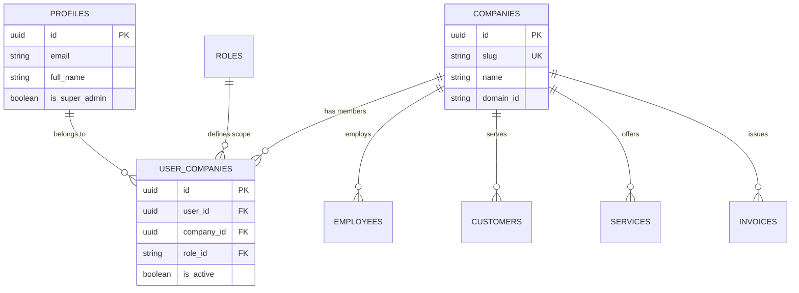

# Jay Murlidhar Group (JMG)
## Multi-Company Business Management Platform — Architecture Blueprint (Phase 1)

---

### 1. Project Purpose & Strategic Vision

The Jay Murlidhar Group (JMG) operates across six distinct business domains. The current codebase powers the high-performance, public-facing brand and ecosystem website (`www.jaymurlidhargroup.co.in`).

This architecture blueprint establishes the foundation for extending the digital ecosystem into a **Production-Grade Multi-Company Business Management Platform** (`app.jaymurlidhargroup.co.in`).

#### Core Architectural Capabilities
- **One User → Multiple Companies**: Single sign-on identity with access across authorized group entities.
- **Company Switcher**: Seamless toggling between consolidated group view (`ALL`) and company-scoped operational views.
- **Strict Multi-Tenancy**: Data segregation enforced at the database level via PostgreSQL Row Level Security (RLS).
- **Comprehensive Business Lifecycle**: End-to-end management of employees, customers, service catalogs, inbound enquiries, finance (income/expenses), billing/invoicing, business reports, and tamper-evident audit logs.

---

### 2. Public Website vs. Private Application Separation

| Attribute | Public Website | Private Business Platform |
| :--- | :--- | :--- |
| **Primary Domain** | `www.jaymurlidhargroup.co.in` | `app.jaymurlidhargroup.co.in` |
| **Access Model** | Public, unauthenticated, indexable | Strictly authenticated (Supabase Auth + MFA) |
| **Primary Audience** | Clients, citizens, partners, talent | Group leadership, company managers, operational employees |
| **Security Layer** | Standard HTTPS, CORS, CSP | Session JWT, RLS, RBAC, Audit Logging |
| **Routing Prefix** | `/`, `/technology`, `/jan-suvidha`, etc. | `/admin/*` (`/admin/login`, `/admin/companies`, etc.) |
| **Rendering Strategy** | Client-Side SPA with fast TTFB & SEO metadata | Authenticated dashboard SPA with real-time subscriptions |

The public website remains completely isolated from internal management operations. Public routes require zero authentication and have no dependencies on internal management state.

---

### 3. Canonical Domain Architecture

JMG is structured into six canonical, non-overlapping domains:

```
                      ┌─────────────────────────────────┐
                      │    JAY MURLIDHAR GROUP (JMG)    │
                      └────────────────┬────────────────┘
                                       │
     ┌──────────────┬──────────────┬───┴──────────┬──────────────┬──────────────┐
     │              │              │              │              │              │
┌────┴─────┐ ┌──────┴──────┐ ┌─────┴─────┐ ┌──────┴─────┐ ┌──────┴─────┐ ┌──────┴─────┐
│    01    │ │     02      │ │    03     │ │     04     │ │    05     │ │    06     │
│TECHNOLOGY│ │ JAN SUVIDHA │ │ INSURANCE │ │  BUSINESS  │ │   TRAVEL   │ │    RETAIL   │
│          │ │ (CSC/KIOSK) │ │           │ │  SERVICES  │ │            │ │             │
└──────────┘ └─────────────┘ └───────────┘ └────────────┘ └────────────┘ └─────────────┘
```

1. **Technology (`technology`)**: Custom software engineering, enterprise cloud solutions, intelligent automation, and modern web application platforms.
2. **Jan Suvidha (`jan-suvidha`)**: Citizen and public services kiosk, Common Services Centre (CSC) digital delivery, government scheme facilitation, and vocational IT skill courses.
3. **Insurance (`insurance`)**: Institutional liability mitigation, corporate underwriting, life/general coverage, and dedicated claims advocacy.
4. **Business Services (`business-services`)**: Statutory compliance, corporate tax filings (GST, IT), MSME registrations, legal certifications, and commercial advisory.
5. **Travel (`travel`)**: University institutional delegations, academic study tours, faculty expeditions, and corporate itinerary management.
6. **Retail (`retail`)**: Smart mobility hardware distribution, student computing equipment provisioning, and certified electronics servicing.

---

### 4. Canonical Company Architecture

Six operating companies represent JMG's active corporate entities. 

> [!IMPORTANT]
> **Canonical Domain Assignment for Jay Murlidhar Computer**:
> Jay Murlidhar Computer strictly belongs to the **Jan Suvidha / CSC** domain. It is a neighbourhood digital public services kiosk and digital skills center. It is **NOT** part of the Technology domain.

| Company Name | Identifier (`id`) | Code | Domain | Public Route | Core Function |
| :--- | :--- | :--- | :--- | :--- | :--- |
| **Jay Murlidhar Tech Solutions** | `jay-murlidhar-tech-solutions` | `JMTS` | Technology | `/technology/jay-murlidhar-tech-solutions` | Custom software, cloud, APIs, automation |
| **Jay Murlidhar Computer** | `jay-murlidhar-computer` | `JMC` | Jan Suvidha | `/jan-suvidha/jay-murlidhar-computer` | CSC public kiosk, G2C/B2C services, IT skills |
| **Jay Murlidhar Insurance** | `jay-murlidhar-insurance` | `JMI` | Insurance | `/insurance/jay-murlidhar-insurance` | General/life insurance, risk consultancy |
| **Jay Murlidhar Business Services** | `jay-murlidhar-business-services` | `JMBS` | Business Services | `/business-services/jay-murlidhar-business-services` | GST, MSME, PAN, Shop Act, company filing |
| **Jay Murlidhar Tours** | `jay-murlidhar-tours` | `JMT` | Travel | `/travel/jay-murlidhar-tours` | Institutional study tours & logistics |
| **Jay Murlidhar Mobile & Accessories** | `jay-murlidhar-mobile-accessories` | `JMMA` | Retail | `/retail/jay-murlidhar-mobile-accessories` | Mobility devices, student hardware, repairs |

---

### 5. User-to-Company Relationship & Context Model

A single authenticated user can be associated with multiple companies with distinct roles per company.



#### Company Context State Contract (`src/contexts/CompanyContext.jsx`)
- `currentCompany`: Either the specific company object (e.g. `Jay Murlidhar Insurance`) or the sentinel value `'ALL'` representing the consolidated group view.
- `availableCompanies`: Array of companies the authenticated user has verified permissions to access.
- `isAllCompanies`: Boolean indicating whether the user is currently viewing the consolidated group dashboard.
- `switchCompany(companyId)`: Action to switch active operational context.

---

### 6. Role-Based Access Control (RBAC) Architecture

Authentication (identity verification) is cleanly decoupled from Authorization (access rights).

#### Tiered Roles
1. **Group Owner / Super Admin (`group_owner`)**:
   - Unrestricted access across all six companies.
   - Global consolidated dashboard view (`currentCompany = 'ALL'`).
   - Company creation, global settings, financial consolidation, and system audit logs.
2. **Company Manager (`company_manager`)**:
   - Administrative and operational authority strictly scoped to one or more assigned companies.
   - Invoicing, employee assignment, customer records, and local financial tracking.
   - No access to unassigned sibling companies.
3. **Employee / Staff (`employee`)**:
   - Operational task execution (e.g. managing enquiries, recording services delivered, drafting invoices).
   - Read/write access strictly limited to designated functional modules within their assigned company.

#### Functional Permission Matrix
| Module | Action | Super Admin | Company Manager | Employee |
| :--- | :--- | :---: | :---: | :---: |
| **Companies** | Create / Edit / Delete | Full (Global) | None | None |
| **Employees** | Invite / Manage / Terminate | Full (Global) | Scoped to assigned company | None |
| **Customers** | View / Create / Update | Full (Global) | Scoped to assigned company | Scoped to assigned company |
| **Services** | Catalog Management | Full (Global) | Scoped to assigned company | Read only |
| **Enquiries** | Pipeline & Status Tracking | Full (Global) | Scoped to assigned company | Scoped to assigned company |
| **Finance** | Income & Expense Records | Full (Global) | Scoped to assigned company | Read / Draft |
| **Invoices** | Issue / Cancel / Reconcile | Full (Global) | Scoped to assigned company | Draft only |
| **Reports** | Operational & P&L Analysis | Full (Consolidated) | Scoped to assigned company | None |
| **Audit Logs** | System Event Inspection | Full (Immutable) | Scoped to assigned company | None |

---

### 7. Database Architecture Plan (PostgreSQL / Supabase)

All tables strictly enforce multi-tenancy using `company_id` foreign keys with database-level cascading rules.

```sql
-- 1. PROFILES (Extends auth.users)
CREATE TABLE public.profiles (
    id UUID PRIMARY KEY REFERENCES auth.users(id) ON DELETE CASCADE,
    email TEXT NOT NULL UNIQUE,
    full_name TEXT NOT NULL,
    avatar_url TEXT,
    is_super_admin BOOLEAN NOT NULL DEFAULT false,
    created_at TIMESTAMPTZ NOT NULL DEFAULT now(),
    updated_at TIMESTAMPTZ NOT NULL DEFAULT now()
);

-- 2. DOMAINS
CREATE TABLE public.domains (
    id TEXT PRIMARY KEY, -- 'technology', 'jan-suvidha', etc.
    name TEXT NOT NULL,
    description TEXT,
    created_at TIMESTAMPTZ NOT NULL DEFAULT now()
);

-- 3. COMPANIES
CREATE TABLE public.companies (
    id UUID PRIMARY KEY DEFAULT gen_random_uuid(),
    slug TEXT NOT NULL UNIQUE,
    code TEXT NOT NULL UNIQUE,
    name TEXT NOT NULL,
    domain_id TEXT NOT NULL REFERENCES public.domains(id),
    is_active BOOLEAN NOT NULL DEFAULT true,
    created_at TIMESTAMPTZ NOT NULL DEFAULT now()
);

-- 4. USER_COMPANIES (Many-to-Many Bridge with Scoped Roles)
CREATE TABLE public.user_companies (
    id UUID PRIMARY KEY DEFAULT gen_random_uuid(),
    user_id UUID NOT NULL REFERENCES public.profiles(id) ON DELETE CASCADE,
    company_id UUID NOT NULL REFERENCES public.companies(id) ON DELETE CASCADE,
    role TEXT NOT NULL CHECK (role IN ('group_owner', 'company_manager', 'employee')),
    is_active BOOLEAN NOT NULL DEFAULT true,
    created_at TIMESTAMPTZ NOT NULL DEFAULT now(),
    UNIQUE(user_id, company_id)
);

-- 5. EMPLOYEES
CREATE TABLE public.employees (
    id UUID PRIMARY KEY DEFAULT gen_random_uuid(),
    company_id UUID NOT NULL REFERENCES public.companies(id) ON DELETE CASCADE,
    user_id UUID REFERENCES public.profiles(id) ON DELETE SET NULL,
    first_name TEXT NOT NULL,
    last_name TEXT NOT NULL,
    designation TEXT NOT NULL,
    department TEXT,
    is_active BOOLEAN NOT NULL DEFAULT true,
    created_at TIMESTAMPTZ NOT NULL DEFAULT now()
);

-- 6. CUSTOMERS
CREATE TABLE public.customers (
    id UUID PRIMARY KEY DEFAULT gen_random_uuid(),
    company_id UUID NOT NULL REFERENCES public.companies(id) ON DELETE CASCADE,
    name TEXT NOT NULL,
    email TEXT,
    phone TEXT,
    organization TEXT,
    created_at TIMESTAMPTZ NOT NULL DEFAULT now()
);

-- 7. SERVICES
CREATE TABLE public.services (
    id UUID PRIMARY KEY DEFAULT gen_random_uuid(),
    company_id UUID NOT NULL REFERENCES public.companies(id) ON DELETE CASCADE,
    title TEXT NOT NULL,
    code TEXT,
    base_price NUMERIC(12,2) DEFAULT 0.00,
    is_active BOOLEAN NOT NULL DEFAULT true,
    created_at TIMESTAMPTZ NOT NULL DEFAULT now()
);

-- 8. ENQUIRIES
CREATE TABLE public.enquiries (
    id UUID PRIMARY KEY DEFAULT gen_random_uuid(),
    company_id UUID NOT NULL REFERENCES public.companies(id) ON DELETE CASCADE,
    customer_id UUID REFERENCES public.customers(id) ON DELETE SET NULL,
    subject TEXT NOT NULL,
    details TEXT,
    status TEXT NOT NULL DEFAULT 'pending' CHECK (status IN ('pending', 'in_progress', 'resolved', 'closed')),
    created_at TIMESTAMPTZ NOT NULL DEFAULT now()
);

-- 9. INVOICES & INVOICE_ITEMS
CREATE TABLE public.invoices (
    id UUID PRIMARY KEY DEFAULT gen_random_uuid(),
    company_id UUID NOT NULL REFERENCES public.companies(id) ON DELETE CASCADE,
    customer_id UUID NOT NULL REFERENCES public.customers(id),
    invoice_number TEXT NOT NULL UNIQUE,
    issue_date DATE NOT NULL DEFAULT CURRENT_DATE,
    due_date DATE NOT NULL,
    subtotal NUMERIC(12,2) NOT NULL DEFAULT 0.00,
    tax_amount NUMERIC(12,2) NOT NULL DEFAULT 0.00,
    total_amount NUMERIC(12,2) NOT NULL DEFAULT 0.00,
    status TEXT NOT NULL DEFAULT 'draft' CHECK (status IN ('draft', 'sent', 'paid', 'overdue', 'cancelled')),
    created_at TIMESTAMPTZ NOT NULL DEFAULT now()
);

CREATE TABLE public.invoice_items (
    id UUID PRIMARY KEY DEFAULT gen_random_uuid(),
    invoice_id UUID NOT NULL REFERENCES public.invoices(id) ON DELETE CASCADE,
    service_id UUID REFERENCES public.services(id),
    description TEXT NOT NULL,
    quantity INT NOT NULL DEFAULT 1,
    unit_price NUMERIC(12,2) NOT NULL,
    amount NUMERIC(12,2) NOT NULL
);

-- 10. FINANCE: INCOME & EXPENSES
CREATE TABLE public.income (
    id UUID PRIMARY KEY DEFAULT gen_random_uuid(),
    company_id UUID NOT NULL REFERENCES public.companies(id) ON DELETE CASCADE,
    invoice_id UUID REFERENCES public.invoices(id),
    amount NUMERIC(12,2) NOT NULL,
    category TEXT NOT NULL,
    recorded_date DATE NOT NULL DEFAULT CURRENT_DATE,
    created_at TIMESTAMPTZ NOT NULL DEFAULT now()
);

CREATE TABLE public.expenses (
    id UUID PRIMARY KEY DEFAULT gen_random_uuid(),
    company_id UUID NOT NULL REFERENCES public.companies(id) ON DELETE CASCADE,
    amount NUMERIC(12,2) NOT NULL,
    category TEXT NOT NULL,
    description TEXT,
    recorded_date DATE NOT NULL DEFAULT CURRENT_DATE,
    created_at TIMESTAMPTZ NOT NULL DEFAULT now()
);

-- 11. AUDIT_LOGS
CREATE TABLE public.audit_logs (
    id UUID PRIMARY KEY DEFAULT gen_random_uuid(),
    company_id UUID REFERENCES public.companies(id) ON DELETE SET NULL,
    user_id UUID REFERENCES public.profiles(id),
    action TEXT NOT NULL,
    entity_name TEXT NOT NULL,
    entity_id UUID,
    payload JSONB,
    ip_address INET,
    created_at TIMESTAMPTZ NOT NULL DEFAULT now()
);
```

---

### 8. Security Architecture & Row Level Security (RLS)

Security is anchored on the principle of **Zero Trust at the API Layer**. Client-side UI guards are convenience features; access control is definitively enforced by PostgreSQL RLS.

#### RLS Enforcement Model
Every table with a `company_id` column activates RLS:
```sql
ALTER TABLE public.customers ENABLE ROW LEVEL SECURITY;

CREATE POLICY "Users can only access records belonging to their assigned companies"
ON public.customers
FOR ALL
USING (
    -- Group Super Admins have universal access
    EXISTS (
        SELECT 1 FROM public.profiles
        WHERE profiles.id = auth.uid() AND profiles.is_super_admin = true
    )
    OR
    -- Regular users must be assigned to the company
    EXISTS (
        SELECT 1 FROM public.user_companies
        WHERE user_companies.user_id = auth.uid()
          AND user_companies.company_id = customers.company_id
          AND user_companies.is_active = true
    )
);
```

#### Secrets Management & Client Hygiene
- **Allowed Frontend Variables**: Only `VITE_SUPABASE_URL` and `VITE_SUPABASE_ANON_KEY` are bundled with client code.
- **Forbidden in Client Code**: Supabase Service Role Key (`SUPABASE_SERVICE_ROLE_KEY`), master DB credentials, or direct connection strings must **never** be imported, bundled, or committed.

---

### 9. Future Routing Architecture

```
/ (Root)
│
├── [PUBLIC ROUTES] (PublicLayout / MainLayout)
│   ├── / (Home)
│   ├── /about
│   ├── /ecosystem
│   ├── /solutions
│   ├── /projects
│   ├── /careers (/jobs, /internships)
│   ├── /contact
│   ├── /technology
│   │   └── /technology/jay-murlidhar-tech-solutions
│   ├── /jan-suvidha
│   │   └── /jan-suvidha/jay-murlidhar-computer
│   ├── /insurance
│   │   └── /insurance/jay-murlidhar-insurance
│   ├── /business-services
│   │   └── /business-services/jay-murlidhar-business-services
│   ├── /travel
│   │   └── /travel/jay-murlidhar-tours
│   └── /retail
│       └── /retail/jay-murlidhar-mobile-accessories
│
└── [PRIVATE ROUTES] (AdminLayout / ProtectedRoute)
    ├── /admin/login (Unauthenticated entry)
    │
    └── /admin (Authenticated Dashboard Shell)
        ├── /admin (Overview / Consolidated Dashboard)
        ├── /admin/companies (Group Owner only)
        ├── /admin/employees
        ├── /admin/customers
        ├── /admin/services
        ├── /admin/enquiries
        ├── /admin/income
        ├── /admin/expenses
        ├── /admin/invoices
        ├── /admin/reports
        ├── /admin/analytics
        └── /admin/settings
```

---

### 10. Deployment & Subdomain Strategy

1. **Public Website (`www.jaymurlidhargroup.co.in`)**:
   - Deployed on Vercel / Cloudflare Pages.
   - SPA Fallbacks handled via `vercel.json` rewrites and `public/_redirects`.
   - Optimized for Core Web Vitals, metadata SEO tags, canonical URL links.
2. **Management App (`app.jaymurlidhargroup.co.in`)**:
   - Subdomain DNS configured to point to the management application build.
   - Strict CORS configuration limiting Supabase authenticated origin requests to `app.jaymurlidhargroup.co.in` and `localhost:5173`.

---

### 11. Phase 2 Implemented Database Schema & Migrations

Version-controlled SQL migrations are located under `supabase/migrations/`:

#### Migration 1: `20261001000001_core_schema.sql`
- **Extensions**: `uuid-ossp`, `pgcrypto`
- **Helper Functions**:
  - `public.handle_updated_at()`: Trigger function auto-updating `updated_at` timestamps on row mutation.
  - `public.handle_new_user()`: Trigger function auto-populating `public.profiles` on `auth.users` insert.
  - `public.is_super_admin()`: Security definer query verifying `group_owner` role membership.
  - `public.has_company_access(target_company_id)`: Security definer function checking user-company assignment.
- **Core Entities**:
  - `domains` (`id`, `name`, `slug`, `description`, `is_active`, `created_at`, `updated_at`)
  - `companies` (`id`, `name`, `slug`, `legal_name`, `description`, `logo_url`, `domain_id`, `is_active`, `created_at`, `updated_at`)
  - `profiles` (`id` references `auth.users(id)`, `full_name`, `email`, `phone`, `avatar_url`, `is_active`, `created_at`, `updated_at`)
  - `roles` (`id`, `name`, `slug`, `description`, `created_at`)
  - `permissions` (`id`, `module`, `action`, `description`, `created_at`, unique `(module, action)`)
  - `role_permissions` (`id`, `role_id`, `permission_id`, `created_at`, unique `(role_id, permission_id)`)
  - `user_companies` (`id`, `user_id`, `company_id`, `role_id`, `is_primary`, `is_active`, `created_at`, `updated_at`, unique `(user_id, company_id)`)
- **Indexes**:
  - `idx_domains_slug`, `idx_companies_slug`, `idx_companies_domain_id`, `idx_profiles_email`, `idx_roles_slug`
  - `idx_permissions_module`, `idx_permissions_action`, `idx_role_permissions_role_id`, `idx_role_permissions_permission_id`
  - `idx_user_companies_user_id`, `idx_user_companies_company_id`, `idx_user_companies_role_id`
- **Row Level Security**:
  - Activated across all 7 core tables with non-bypassable, authenticated role-based policies.

#### Migration 2: `20261001000002_seed_canonical_data.sql`
- **6 Canonical Domains**:
  1. `technology` (Technology)
  2. `jan-suvidha` (Jan Suvidha)
  3. `insurance` (Insurance)
  4. `business-services` (Business Services)
  5. `travel` (Travel)
  6. `retail` (Retail)
- **6 Canonical Companies**:
  1. `jay-murlidhar-tech-solutions` → `technology`
  2. `jay-murlidhar-computer` → `jan-suvidha` (*Strictly Jan Suvidha / CSC, NOT Technology*)
  3. `jay-murlidhar-insurance` → `insurance`
  4. `jay-murlidhar-business-services` → `business-services`
  5. `jay-murlidhar-tours` → `travel`
  6. `jay-murlidhar-mobile-accessories` → `retail`
- **3 Roles**:
  1. `group_owner` (Group Owner / Super Admin)
  2. `company_manager` (Company Manager)
  3. `employee` (Employee)
- **Permissions System**:
  - Normalized across modules: `companies`, `employees`, `customers`, `services`, `enquiries`, `finance`, `reports`, `analytics`, `settings`.
- **Role Permission Maps**:
  - `group_owner`: Universal grant across all actions.
  - `company_manager`: Administrative & business management permissions for assigned entities.
  - `employee`: Scoped operational access.

